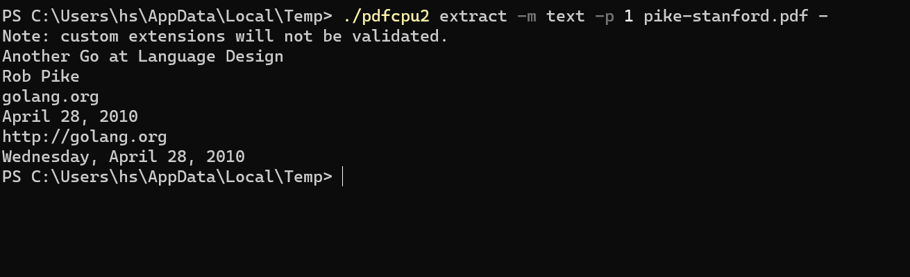
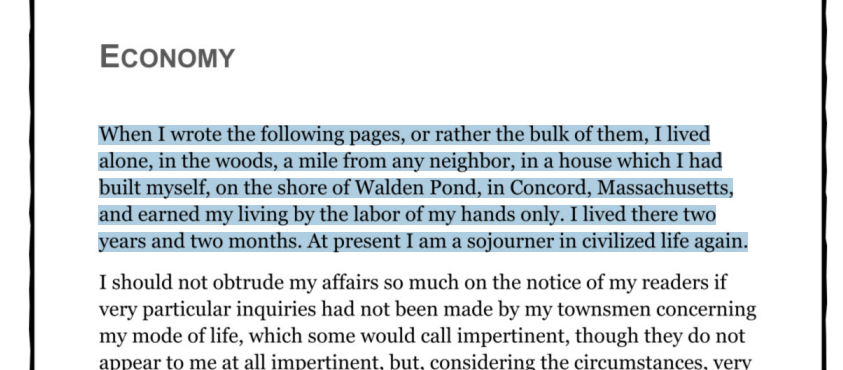
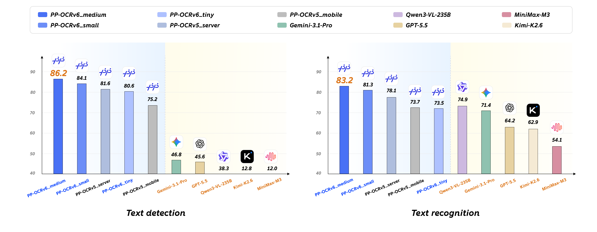

# pdfcpu2

pdfcpu2 是 pdfcpu 的一个分支，在保留原有 PDF 处理命令的基础上，增加了离线 OCR 和文本提取功能。可编译为单个静态二进制文件，不依赖 Python、cgo 或外部服务。

```sh
pdfcpu2 ocr scan.pdf scan_ocr.pdf && pdfcpu2 extract -m text scan_ocr.pdf -
```

这条命令会先为扫描版 PDF 添加可搜索的文本层，再提取其中的文本。这套流程可用于 RAG 数据导入、Agent 工具和批量文档处理。

| `pdfcpu2 extract -m text`：从 PDF 中提取文本 | `pdfcpu2 ocr`：为扫描件添加不可见、可选择的文本层 |
| --- | --- |
|  |  |

## 文档

[项目 Wiki](https://github.com/huzpsb/pdfcpu2/wiki) 包含约 60 页文档，涵盖命令行用法、Go API 示例和入门指南。

## 动机

pdfcpu 的维护者 Horst Rutter 是 PDF Association 的成员。我敬佩他对 PDF 标准的坚持，但我的确需要文本提取、OCR 等功能。尊重归尊重，这些需求并不会因此消失，所以我把它们加到了这个分支里，自己也在用。

## 功能

- **单个二进制文件。** PP-OCRv6 检测和识别模型（约 6 MB）已嵌入可执行文件。OCR 可完全离线运行，无需 API 密钥或令牌，没有调用频率限制，数据也不会离开本机。支持 Windows、Linux 和 macOS 的 amd64、arm64 版本。
- **纯 Go OCR 推理。** 模型基于纯 Go 引擎运行，使用 fp32 标量计算和 goroutine 并行，不需要 cgo、ONNX Runtime 或 Python。
- **OCR 基准测试。** PaddlePaddle 公布的基准测试给出了 PP-OCRv6 与数个通用 VLM 的以下结果：

  

  | 模型 | 文本检测 | 文本识别 |
  | --- | --- | --- |
  | PP-OCRv6_medium | **86.2** | **83.2** |
  | PP-OCRv6_small | 84.1 | 81.3 |
  | **PP-OCRv6_tiny**（内嵌） | 80.6 | 73.5 |
  | Gemini-3.1-Pro | 46.8 | 71.4 |
  | GPT-5.5 | 45.6 | 64.2 |
  | Qwen3-VL-235B | 38.3 | 74.9 |

  来源：[PP-OCRv6 模型卡片](https://www.modelscope.cn/models/PaddlePaddle/PP-OCRv6_small_rec_onnx)。这类专用模型也没有按页计算的 API 调用费用。
- **与 PDFBox 兼容的文本提取。** `extract -m text` 遵循 Apache PDFBox 默认提取器的行为，并基于 1,200 多份不同时期、不同生成器的中文真实 PDF，通过与 PDFBox 的差分测试调整行为。
- **CJK 支持。** 文本提取支持 ToUnicode CMap（包括 Type42 和数组形式的 `bfrange`）、内嵌 TrueType cmap、旧式 GBK／Big5、Adobe-GB1／CNS1 CID 回退，以及最后兜底的 Latin-1。OCR 模型针对中文和英文训练。
- **可重复执行的 OCR。** 已处理的图像会被标记，再次运行 `ocr` 时只处理新增内容。文本以不可见图层写入，并通过每张图像的页面变换进行映射，使选择位置与可见字形对齐。
- **命令行与 API 集成。** 支持标准输入／输出流（`-`）、页面选择和 JSON 输出，Go API 支持通过 `context.Context` 取消操作。

## 新增命令

| 功能 | 命令 | 状态 |
| --- | --- | --- |
| 纯文本提取（与 PDFBox 兼容） | `pdfcpu2 extract -m text` | 可用 |
| 为扫描版 PDF 添加不可见的 OCR 文本层 | `pdfcpu2 ocr` | 可用 |
| 页面渲染／栅格化 | `pdfcpu2 render` | 计划中 |

```sh
# 文本提取
pdfcpu2 extract -m text in.pdf out.txt          # 整个文档
pdfcpu2 extract -m text -p 1-3 in.pdf -         # 将第 1—3 页输出到标准输出

# OCR：让扫描件可搜索、可提取文本
pdfcpu2 ocr scan.pdf scan_ocr.pdf               # 所有页面
pdfcpu2 ocr scan.pdf scan_ocr.pdf -pages 1-10   # 指定页面
```

Go API 示例：

```go
conf := model.NewDefaultConfiguration()
ctx := context.Background()

n, err := api.OCRFile(ctx, "scan.pdf", "scan_ocr.pdf", nil, conf) // 处理的图像数量
err = api.ExtractTextFile(ctx, "scan_ocr.pdf", "out.txt", nil, nil, conf)

// 也可以提取带行坐标的结构化文本：
texts, err := api.ExtractText(ctx, rs, []string{"1-3"}, nil, conf) // []pdfcpu.PageText
```

## 原有 PDF 命令

现有命令集仍然可用，包括验证、优化、合并、拆分与裁剪、页面和页面框、图章与水印、表单、加密、权限、签名、附件、PDF 创建、n-up 拼版、小册子和海报等。

```sh
pdfcpu2 validate in.pdf
pdfcpu2 merge out.pdf a.pdf b.pdf
pdfcpu2 encrypt --opw owner --upw user in.pdf out.pdf   # AES-256
pdfcpu2 stamp add "CONFIDENTIAL" "pos:tr, op:.6" in.pdf out.pdf
```

## 安装

```sh
go install github.com/huzpsb/pdfcpu2/cmd/pdfcpu2@latest
# 或从源码目录构建：
go mod vendor && go build ./cmd/pdfcpu2
```

作为库使用：

```sh
go get github.com/huzpsb/pdfcpu2
```

## 与上游项目的关系

pdfcpu2 是 pdfcpu 的硬分支，独立维护，采用 Apache 2.0 许可证，不保证跟随上游版本发布。欢迎提交 issue 和合理的功能需求。

现有行为和 API 约定在可行范围内保持兼容。新代码沿用现有包分层：`model` → `pkg/pdfcpu` → `pkg/api` → `pkg/cli`。

上游项目：[pdfcpu](https://github.com/pdfcpu/pdfcpu)。

## 许可证

采用 Apache License 2.0，与上游一致（见 `LICENSE.txt`）。内嵌的 Adobe CID 到 Unicode 映射表派生自 Adobe 的 UCS2 CMap 资源（Adobe BSD 风格许可证；版权声明保留在生成文件的头部）。
